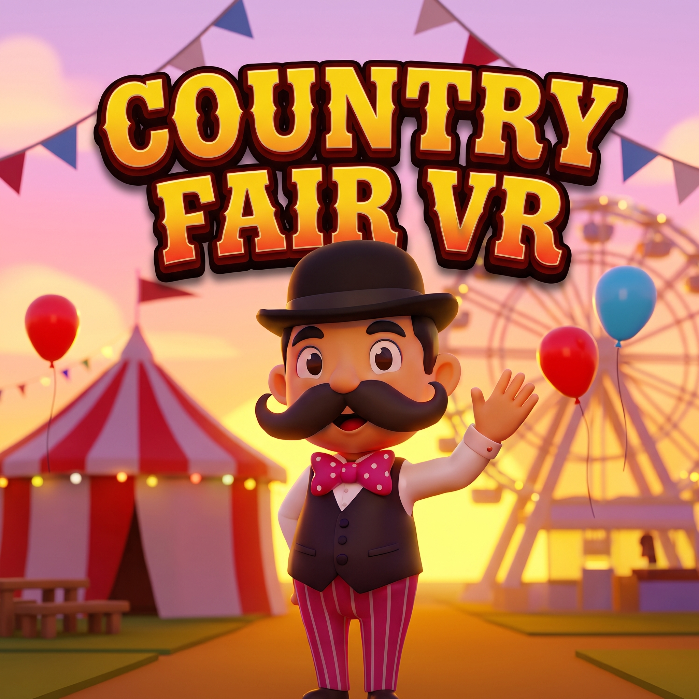
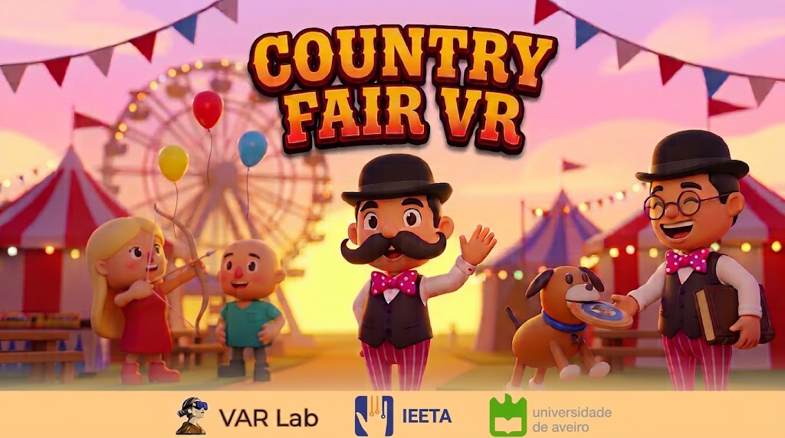
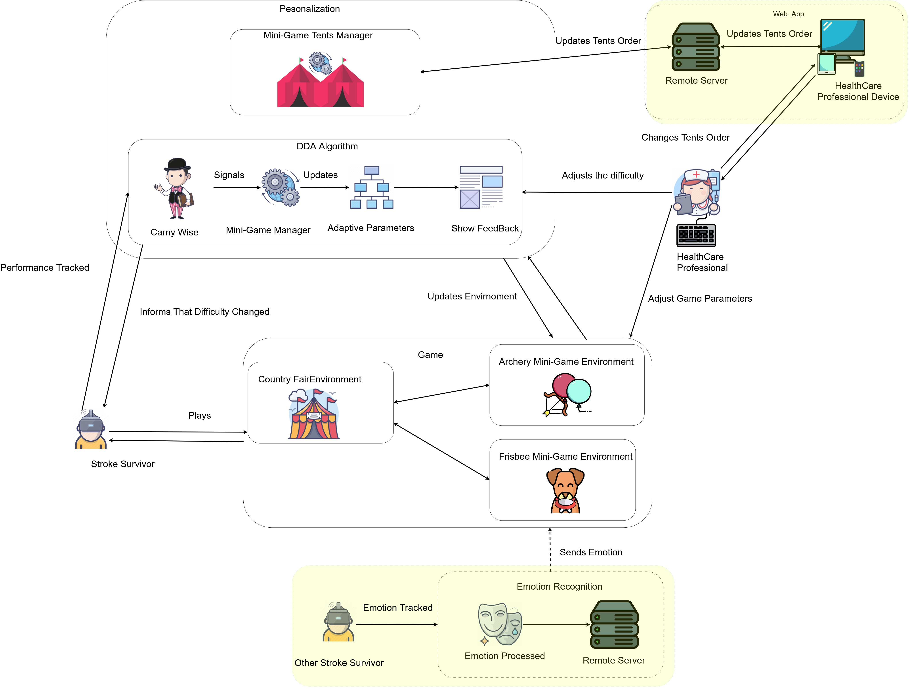
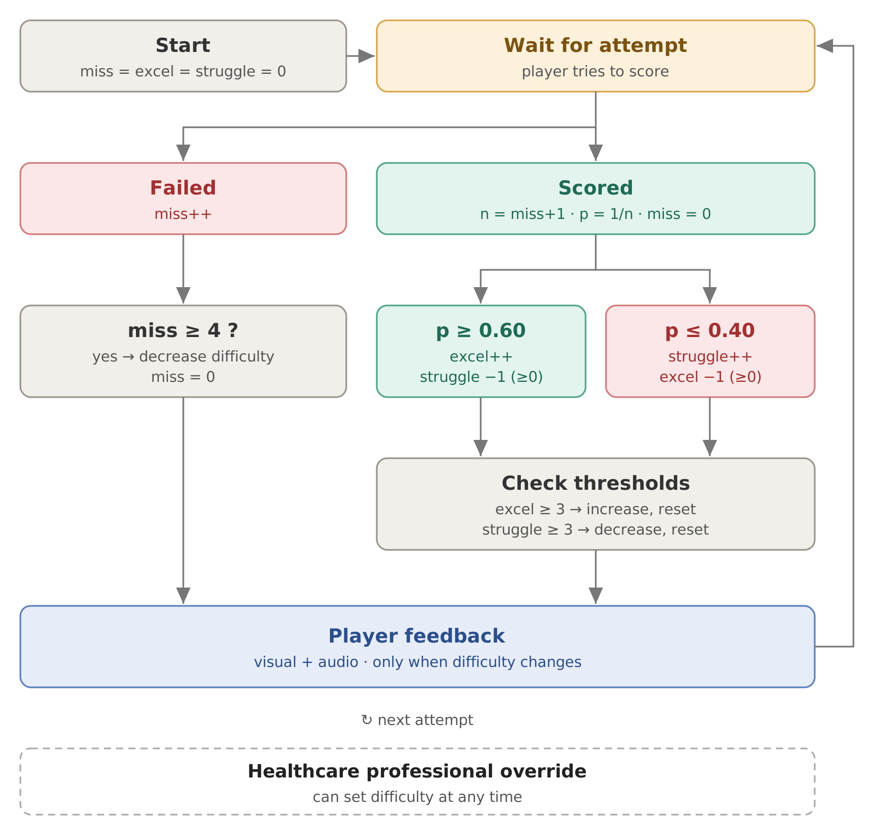

#  Personalized CountryFair VR

A VR serious game for stroke rehabilitation, featuring adaptive mini-games in an immersive country fair environment built for Meta Quest 3 with hand-tracking support. It aims to enhance post-stroke rehabilitation through gamified exercises targeting upper-limb motor recovery, with a difficulty that continuously adapts to the player's performance.

This repository contains the source code developed as part of a Master's Thesis titled *"Exploring the Effect of a Personalized Virtual Reality Serious Game for Stroke Rehabilitation"*, focused on stroke survivor rehabilitation using Virtual Reality Serious Games. The system was developed using a Human-Centered Design methodology in collaboration with the **Rovisco Pais Rehabilitation Center**. A usability study was run with **38 healthy adults**; clinical validation with stroke survivors has not been carried out yet (see [🧪 User Testing](#-user-testing)).



---

# 📺 Demo

### [CountryFair VR Demo](https://www.youtube.com/watch?v=bDXMD0OPzRI)

---

# 🎯 The Problem

Traditional post-stroke rehabilitation often suffers from low patient adherence due to the monotony of repetitive exercises and a lack of personalization in the therapeutic process.

Immersive VR games can also leave survivors feeling **isolated and lost**: alone in an empty virtual space, with no social presence and little guidance on where to look or what to do next.

---

# 💡 Our Approach

We propose a solution set in a VR Country Fair environment, designed to enhance stroke survivor motivation and engagement. The system offers:

- **Immersive virtual reality mini-games** that make repetitive exercises more fun and motivating.
- **Hybrid personalization**: automatic adaptation combined with direct clinician control.
  - **Automatic adjustment (CarnyWise):** the games get easier or harder in real time depending on how the player is doing, keeping the challenge at the right level.
  - **Healthcare professional override:** healthcare professionals can step in at any time to change the difficulty and manage the session manually.
- **NPCs**: characters that keep the player from feeling alone or isolated.
  - **Companions:** a dog that plays with the player in the Frisbee game, and characters (such as Zeca Bigodes and Carny Wise) that narrate events and guide the player through narrated dialogues and tutorials.
  - **Background NPCs:** wandering people, animals and crowds that make the fair feel alive.
- **Natural hand-tracking interaction** on Meta Quest 3, so players can play with their own hands, without controllers.
- **Immersive spatial 3D sound** that reinforces the fair atmosphere and helps guide the player, so they do not feel lost in the environment.
- **A personalized fair** where healthcare professionals can rearrange the mini-game tents before each session to choose the order of the activities.

## Implemented Mini-games

- 🏹🎈 **Archery (`ArcheryGame.unity`):** A balloon-target shooting game where the player uses a virtual bow (hand-tracking via `BowHandTracking.cs`, trajectory preview via `TrajectoryLine.cs`). `ArcheryGameManager.cs` spawns colored balloons inside a defined volume and uses AnimationCurves to scale balloon count, movement ratio, transparency ratio, and movement speed with difficulty.
- 🥏🐶 **Frisbee (`FrisbeeGame.unity`):** A throwing game where the player tosses a frisbee for a dog to catch. `FrisbeeGameManager.cs` spawns score areas around the player at adaptive distances and uses AnimationCurves to control movement and visibility ratios. Dog AI is driven by a five-state FSM (`DogIdle`, `GoToTarget`, `Jump`, `CatchFrisbee`, `GiveFrisbeeToPlayer`).

---

# 🧪 User Testing

A formal study with **38 healthy adults** (ages 21–57, mostly students; 17 had used VR before) played seated on a Meta Quest 3, mainly at the VAR Lab, IEETA. Each participant picked a mini-game and completed Frisbee and Archery. The observer used a Bluetooth keyboard (cheat codes) to skip tutorials and force difficulty changes. Data came from observer notes and a 7-point Likert questionnaire including the **SUS**.

| Metric | Result |
|---|---|
| Noticed the system adapting the mini-games | **31 (82%)** |
| System adapted to my abilities and needs | **33 (87%)** |
| **SUS score** | **82 / 100** ("Excellent") |
| Instructions and objectives were clear | 31 (82%) |
| Felt immersed in a country fair | 34 (90%) |
| Fair environment was fun, motivating and engaging | 37 (98%) |
| Did not feel overly tired or overwhelmed | 37 (98%) |
| Spatial sound helped guide actions | 25 (65%) |
| Personalized VR could help stroke rehabilitation *(optional, n = 37)* | 32 (86%) |

These measure what players *perceived*, not the adaptation's effect on performance.

**Main issues:** frisbee mechanics (13 participants, 34%), on-screen text too long or hard to read (7), bugs or crashes (7), in-game buttons (5), archery nocking/pulling (4), and the target-color rule going unnoticed (9).

**Later iterations:** the HUD and DDA feedback now follow the player's head, the target-color text uses the balloon's color, dialogue is narrated (see 🎙️ Character Voices), and the arrow trajectory changes color.

### Limitations

- **No clinical participants:** the study was run with healthy adults, not stroke survivors. The planned clinical validation at the **Rovisco Pais Rehabilitation Center** could not happen within the dissertation's timeline, so therapeutic efficacy, accessibility for motor-impaired users and clinical safety have **not been validated yet**.
- **Bow hand:** in the tested prototype the bow was attached to the left arm. A later change added the `left` / `right` / `head` positioning modes.

---

# 🧠 Emotion Recognition Module (Complementary Work)

This module is **not a primary objective of the dissertation**. It is a complementary integration of the work of **Bianca Guerreiro** (same research group), whose dissertation, *"Exploring Emotion Recognition for Stroke Rehabilitation: Towards Personalized Virtual Reality Serious Game"*, studies how detecting emotions can make personalized VR more adaptive and engaging. It served as a **proof of concept for shared emotional awareness** (one survivor's emotions relayed into another's mini-game) and **validated the architecture's modularity**, since it was plugged in without changes to the game's core.

```
Webcam (laptop) → emotion-recognition pipeline → TCP server
  → ServerListener (Unity, "EXPRESSION;CATEGORY") → EmotionDisplay (Netcode) → one of three representations
```

- **Capture:** a laptop webcam, since no headset with internal face-tracking cameras was available.
- **Transport:** `ServerListener.cs` is a raw TCP client that keeps only the latest message; a failed connection is non-fatal.
- **Sync:** each display is a `NetworkBehaviour` with a server-authoritative `NetworkVariable`, so the therapist's device and the headset show the same state.
- **Representations:** one is chosen at random when entering a mini-game and can be switched with the `e…`, `f…`, `positive` / `negative` cheat codes: **Emoji** and **Facial expression** (`ExpressionDisplay`) and a positive ↔ negative **Slider** (`SliderDisplay`).

Bianca compared the three at the VAR Lab, IEETA (17 participants, within-subjects). All scored above the neutral midpoint, and the **facial expression** scored notably higher on social-emotional connection. Preferences were split almost evenly (slider 6, facial expression 6, emoji 5).

---

# 📚 Publications

This work contributed to the following publications:

| Publication | Part of the work |
|---|---|
| **D. Palricas**, B. Marques, I. Figueiredo, S. Oliveira, B. Guerreiro and B. S. Santos (2026). *Exploring a Virtual Pet as an Adaptive Agent in Personalized VR Rehabilitation: A Country Fair Serious Game for Stroke Survivors*. IEEE ISMAR-Adjunct (2025). | The adaptive virtual pet: the dog of the Frisbee mini-game, which adapts its behavior to the player |
| I. Figueiredo, **D. Palricas**, B. Marques, A. R. Guimarães, S. Oliveira, P. Amorim, et al. (2026). *Addressing Personalized Virtual Reality for Stroke Rehabilitation Through a Country Fair Serious Game Approach: A Proposal*. IEEE VRW, pp. 914–920. | The Country Fair concept and framework: the fair hub and the two mini-games, designed with healthcare professionals |
| B. Guerreiro, **D. Palricas**, I. Figueiredo, S. Oliveira, B. Marques, S. Brás, P. Amorim and B. S. Santos (2026). *Visualization Framework for Shared Emotional Awareness in Personalized VR for Stroke Recovery*. IV, pp. 1–6. | The Emotion Recognition Module and its three representations (emoji, facial expression, slider) |
| I. Figueiredo, B. Marques, **D. Palricas**, S. Oliveira, B. Guerreiro, et al. (2026). *Comparing Methods for Integrating Personalized eXtended Reality in Stroke Rehabilitation*. EUSSET ECSCW, pp. 1–10. | Personalization methods for XR rehabilitation, which underpin the personalization module (DDA) |

---

# 🎤 Events

The project was also presented at the following events:

- **RECPAD 2026** (32nd Portuguese Conference on Pattern Recognition): October 30, 2026, at the School of Technology and Management of Viseu (ESTGV), organized by the Portuguese Association for Pattern Recognition (APRP)
- **ACM SIGGRAPH FSSW** (Faculty Submitted Student Work): ACM SIGGRAPH Education Committee program showcasing exceptional student projects from around the world

---

# 📁 Project Structure

```
CountryFair/
├── Assets/
│   ├── Scenes/
│   │   ├── CountryFair.unity          # Hub world scene
│   │   └── MiniGames/
│   │       ├── ArcheryGame.unity      # Archery mini-game scene
│   │       └── FrisbeeGame.unity      # Frisbee mini-game scene
│   ├── Scripts/
│   │   ├── General/
│   │   │   ├── GameManagment/         # GameManager (singleton, also configures foveated rendering), AudioManager, CheatCodes
│   │   │   ├── Animals/               # Needs-based animal AI (AnimalUtility, AnimalState, AnimalWalk, AnimalEat, AnimalIdle)
│   │   │   ├── Balloons/              # BalloonsSpawner, PopBalloon (hub-world decorative balloons)
│   │   │   ├── Others/                # WanderingPerson, AnimatableState, TextAnim, ButtonPressed
│   │   │   └── UIDialog/              # JSON-driven dialogue base class (UIDialog, JSONData)
│   │   ├── CountryFair/
│   │   │   ├── Management/            # CountryFairAudioManager, CountryFairCheatCodes
│   │   │   ├── Dialogue/              # CountryFairDialogue + JSON data types (IntroData, SessionCompletedData)
│   │   │   ├── Tents/                 # MiniGameTent, TentPlaceHolder, TentsPlaceHolderManager
│   │   │   └── Other/                 # CabinScript, RotateWheel, SheepAnim, CountryFairBalloonSpawner
│   │   ├── MiniGames/
│   │   │   ├── CommonElements/
│   │   │   │   ├── MiniGamesManagment/  # MiniGameManager (abstract), MiniGameAudioManager, MiniGameCheatCodes
│   │   │   │   ├── DDASystem/           # CarnyWise (DDA engine), CarnyWiseDiffFeedback (UI feedback)
│   │   │   │   ├── Tutorial/            # Tutorial, TutorialData
│   │   │   │   ├── UI/                  # ScoreAndStreakSystem, Emotions/ (EmotionDisplay, ExpressionDisplay, SliderDisplay, ServerListener, ConnectionManager)
│   │   │   │   └── ReturnToFair.cs      # Scene transition back to hub
│   │   │   ├── ArcheryGame/
│   │   │   │   ├── GameManagment/       # ArcheryGameManager, ArcheryAudioManager, ArcheryCheatCodes
│   │   │   │   ├── ArcheryStuff/        # BowHandTracking, Arrow, TrajectoryLine
│   │   │   │   ├── Balloons/            # BalloonArcheryGame (target logic: movement, transparency)
│   │   │   │   └── Persons/             # Crowd, IdlePerson (crowd ambient behavior)
│   │   │   ├── FrisbeeGame/
│   │   │   │   ├── GameManagment/       # FrisbeeGameManager, FrisbeeAudioManager, FrisbeeCheatCodes
│   │   │   │   ├── Dog/                 # DogFootSteps + FSM states (DogState, DogIdle, GoToTarget, Jump, CatchFrisbee, GiveFrisbeeToPlayer)
│   │   │   │   ├── Frisbee/             # FrisbeeTrajectory, FollowPlayerHead + FSM states (FrisbeeState, Landed, OnMovement, OnPlayerFront)
│   │   │   │   └── ScoreArea/           # ScoreAreaProperties, ScoreAreaAnimations
│   │   │   └── DuckGame/
│   │   │       └── DuckSwim.cs          # NavMesh-based duck wandering with bobbing and wobble animation
│   │   └── Utils/
│   │       ├── FSM/                   # FSM, State, Transition (generic finite state machine framework)
│   │       └── Utils.cs               # RandomValueInRange, GetChildren helpers
│   └── Plugins/                       # FMOD, DOTween, Meta XR SDK, Demigiant
├── StreamingAssets/
│   └── DialogFiles/                   # JSON files for all dialogue and tutorial content
└── Packages/
    └── manifest.json                  # Unity Package Manager dependencies
```

---

# 🏗️ Architecture Overview



### Singletons / Managers

| Class | Pattern | Responsibility |
|---|---|---|
| `GameManager` | Singleton (non-MonoBehaviour) | Cross-scene session state flags (`IntroCompleted`, `FrisbeeTutorialCompleted`, `ArcheryTutorialCompleted`, `FrisbeeSessionCompleted`, `ArcherySessionCompleted`) |
| `AudioManager` | MonoBehaviour | FMOD event management for shared audio |
| `CountryFairAudioManager` | MonoBehaviour | Hub-world FMOD events |
| `MiniGameAudioManager` (abstract) | MonoBehaviour | Base for `FrisbeeAudioManager`, `ArcheryAudioManager` |

### Scene Composition

Three self-contained scenes connected by `SceneManager.LoadScene`:
- **`CountryFair`** → hub world, intro dialogue, tent selection/rearrangement
- **`ArcheryGame`** / **`FrisbeeGame`** → mini-game sessions; return to `CountryFair` on goal completion via `CarnyWise.SessionGoalReached()`

### Communication Patterns

- **Observer pattern (`UnityEvent<T>`)** primary cross-component wiring done in Inspector: a subject raises an event when its state changes and every listener wired to it is notified, without the subject knowing who they are (e.g., `Tutorial._tutorialCompleted` is a **1:N** relation: when the tutorial ends it fires a single event and three listeners react independently: the mini-game prop is updated (e.g. `Arrow`), `MiniGameManager.TutorialCompleted()` starts the real game, and the cheat codes are told the tutorial is over, which unlocks the ones that only make sense in the real game (e.g. `increase` / `decrease`, which manually change the difficulty in both mini-games). The tutorial knows none of them)
- **`PlayerPrefs`** cross-scene persistence for difficulty levels (`FrisbeeDifficultyLevel`, `ArcheryDifficultyLevel`), dog distance (`DogDistance`), session goal (`SessionGoal`), and scoring color (`BalloonColorToScore`)
- **`NetworkVariable<T>`** (Unity Netcode) server-authoritative sync for `ExpressionDisplay` and `SliderDisplay`

### Performance Patterns

Two optimizations keep the frame rate stable on the Quest 3's mobile hardware:

- **Object Pool (`Utils/ObjectPool.cs`)** a queue of inactive `GameObject`s that are reused instead of being instantiated and destroyed, which avoids garbage-collection hitches mid-game. `GetObject()` dequeues an instance (or instantiates one if the queue is empty), places it **before** activating it so `OnEnable` already sees the final position, and `ReturnObject()` deactivates it and queues it again. `UpdatePoolSize(n)` pre-creates the instances a higher difficulty needs, so they are built at the difficulty change and not while the player is aiming. It is used by `MiniGameManager` for the targets (e.g. the Frisbee score areas in `FrisbeeGameManager`) and by `BalloonsSpawner` for the decorative balloons
- **Foveated Rendering (`GameManager.ConfigureFoveatedRendering()`)** a `[RuntimeInitializeOnLoadMethod]` that enables `OVRManager.useDynamicFoveatedRendering` with level `HighTop` once at startup (values persist across scene loads). The Quest renders the periphery of the view at a lower resolution, where the eye is less sensitive, saving GPU time. It only runs in device builds (`UNITY_ANDROID && !UNITY_EDITOR`), so the Editor has no `OVRManager` dependency

### Finite State Machine (FSM)

`FSM.cs` / `State.cs` / `Transition.cs` a serializable FSM used by both animal ambients and mini-game actors:

```
State (abstract)
└── AnimatableState (adds Animator support)
    ├── AnimalState → AnimalWalk / AnimalEat / AnimalIdle  (needs-based, driven by AnimalUtility)
    ├── DogState    → DogIdle / GoToTarget / Jump / CatchFrisbee / GiveFrisbeeToPlayer
    └── FrisbeeState → OnPlayerFront / OnMovement / Landed
```

### Hybrid Personalization Model (CarnyWise (DDA) + Cheat Codes (Healthcare Professional Manual Override))



#### Consecutive Misses (Safety Net)

When the player misses `failingConsecutiveThreshold` times in a row (default 4) on the same task, the difficulty drops immediately. This may not only mean the level is out of step with the player's performance, but also be a sign of **fatigue** in stroke survivors.

#### Difficulty Change Feedback (`CarnyWiseDiffFeedback.cs`)

Whenever `CarnyWise` changes the difficulty, the player is told through two channels (only when the difficulty actually changes):

- **Visual:** the character (Carny Wise) appears with a text box anchored to the player's field of view. The text is randomized and loaded from `change_difficulty.json`. It never says explicitly that the difficulty changed: it uses subtle hints in common Portuguese colloquial expressions (e.g. *"Isso foi canja. Vamos passar às coisas sérias"* when it gets harder, *"Vamos aliviar um bocado. O importante é não parar"* when it gets easier). The goal is for the player to notice the adjustment, so they do not keep playing against an outdated difficulty and get frustrated by a mismatch between their performance and the challenge they believe they face.
- **Auditory:** the text is **narrated** by the character's voice (FMOD Programmer Instrument + Audio Table, see 🎙️ Character Voices), so the player is aware of the change even when not looking at the text box. This replaced the sound cue used in earlier iterations (and described in the dissertation).

### Emotion Display System

Client side of the colleague's Emotion Recognition Module (see [🧠 Emotion Recognition Module](#-emotion-recognition-module-complementary-work)). `ServerListener` connects via TCP to the external emotion-recognition server, polling at `pollIntervalSeconds` (default 0.5 s). One of three display modes is randomly selected per session:
- **Emoji mode** `ExpressionDisplay` shows one of 7 expression GameObjects (SAD, HAPPY, ANGRY, DISGUST, SURPRISE, FEAR, NEUTRAL)
- **Face mode** second `ExpressionDisplay` instance with a different visual set
- **Slider mode** `SliderDisplay` nudges a cumulative mood bar up (POSITIVE) or down (NEGATIVE)

All three inherit `EmotionDisplay : NetworkBehaviour` and sync state via server-authoritative `NetworkVariable<T>`.

> **Note (testing):** For testing purposes, the emotion-recognition server address in `ServerListener` was set to a static IP.

### Web App Connection

`ConnectToWebApp.cs` connects the game to a companion web app (`CountryFairWebApp/ServerSide`, a Colyseus server) that lets a healthcare professional view/reorder the fair state live. The connection is plain `ws://`, no TLS — a deliberate choice, since the server is meant to run on the same PC whose Mobile Hotspot the headset joins, not on an untrusted network. See **`CLAUDE.md` → "Web App Connection & Cleartext Networking"** for the full setup (required Android/Player Settings, common device-build pitfalls) and the deployment caveat.

---

# 🚀 Getting Started

## Prerequisites

| Requirement | Version |
|---|---|
| **Unity** | 6000.6.8f1 (Unity 6) |
| **Meta Quest 3** | Required for deployment |
| **Blender** *(optional)* | 4.3 or above for editing 3D models |
| **Meta XR Simulator** *(optional)* | 207.1 for testing in the Editor without a headset |
| **FMOD Studio** *(optional)* | 2.03.15 for editing audio events |

## Setup

1. **Clone the repository:**
   ```bash
   git clone https://github.com/DavidPalricas/CountryFair-VR.git
   ```
2. **Open in Unity Hub:** Add the cloned `CountryFair/` folder and ensure Unity **6000.6.8f1** is installed. Unity Hub will prompt to install it if missing.
3. **Resolve packages:** On first open, Unity imports packages from `Packages/manifest.json` (Meta XR SDK v207.0.1, XR Hands v1.9.0, XR OpenXR v1.18.0, Unity Netcode, DOTween). Allow the import to complete before interacting with the Editor.
4. **FMOD setup:** If FMOD banks are not pre-built, open FMOD Studio 2.03.15, load the project's FMOD project file, and build banks to `Assets/StreamingAssets/`.
5. **Run in Editor:** Open `Assets/Scenes/CountryFair.unity` as the start scene and press **Play**. For on-device testing, configure the Meta Quest 3 build profile under **File → Build Settings** (Android, OpenXR).

---

# 🕹️ Controls

| Action | Input |
|---|---|
| Navigate / select (hub) | Meta Quest ray + pinch |
| Grab / rearrange tent | Meta Quest Distance Grab → release over placeholder |
| Draw bow | Pinch (index + middle + ring > 0.25 strength) or primary index trigger > 0.2 |
| Release arrow | Open hand (release pinch) |
| Throw frisbee | Wrist flick gesture detected by `FrisbeeTrajectory.cs` |
| Cheat codes | Type the code on a keyboard (Editor or Bluetooth keyboard on the Quest) or send it from the web app's cheat code panel — see table below |

### Keyboard Cheat Codes (available to healthcare professionals at runtime)

| Input | Function | Context | Precondition |
|---|---|---|---|
| `skip` | Advances the current dialogue by a single line | All scenes | None |
| `intro` | Skips the fair introduction sequence | Fair Scene | Intro not completed |
| `archery` | Loads the Archery mini-game | Fair Scene | Intro completed |
| `frisbee` | Loads the Frisbee mini-game | Fair Scene | Intro completed |
| `duck` / `fishing` | Reserved for the Duck / Fishing mini-games (not implemented yet — only logs a warning) | Fair Scene | Intro completed |
| `giant` | Toggles giant mode (player scaled up/down with a comfort vignette) | Fair Scene | Intro completed |
| `return` | Returns to the Fair Scene | Both mini-games | None |
| `tutorial` | Skips the mini-game tutorial sequence | Both mini-games | Tutorial not completed |
| `goal<N>` + Enter | Sets the session goal to `N` (e.g. `goal15`); `goal` alone uses the default value (10) | Both mini-games | None |
| `increase` | Signals *CarnyWise* to raise the difficulty by one level | Both mini-games | Tutorial completed |
| `decrease` | Signals *CarnyWise* to lower the difficulty by one level | Both mini-games | Tutorial completed |
| `reset` | Resets the difficulty to the first level | Both mini-games | Tutorial completed |
| `complete` | Marks the session goal as reached | Both mini-games | Tutorial completed |
| `e(expression_name)` | Displays the specified emotion via the emoji representation | Both mini-games | Tutorial completed |
| `positive` / `negative` | Shifts the emotion slider right or left, triggering the slider representation | Both mini-games | Tutorial completed |
| `f(expression_name)` | Displays the specified emotion via the facial expression representation | Both mini-games | Tutorial completed |
| `score` | Simulates a successful player score (targets the practice objects during the tutorial's practice phase) | Both mini-games | Tutorial completed or practice phase |
| `miss` | Simulates a player miss | Both mini-games | Tutorial completed or practice phase |
| `dog` | Simulates a score by landing the frisbee in the dog's surrounding area | Frisbee only | Tutorial completed |
| `head` | Makes the bow follow the player's head | Archery only | Tutorial completed |
| `left` | Holds the bow in the left hand | Archery only | Tutorial completed |
| `right` | Holds the bow in the right hand | Archery only | Tutorial completed |

---

# 🎙️ Character Voices

The characters' narrated dialogue lines were generated with [ElevenLabs](https://elevenlabs.io/) using **free-tier voice models in European Portuguese (Portugal)**, so every character speaks in the same language and accent as the on-screen text. The generated clips are played in-game through FMOD (see the narration system in `UIDialog`).

| Character | ElevenLabs Voice | Stability | Similarity |
|---|---|---|---|
| **Zeca Bigodes** | Vicente – *Warm and Raspy* | 40% | 75% |
| **Carny Wise** | Diogo – *Warm and Conversational* | 65% | 75% |

---

# 🛠️ Tools Used

| Tool | Purpose |
|---|---|
| **Unity 6** | Game engine and XR runtime |
| **Blender** | 3D modeling and animation |
| **FMOD Studio** | 3D spatial audio design |
| **ElevenLabs** | Text-to-speech for the characters' narrated dialogue (European Portuguese) |
| **Meta XR SDK** | Hand-tracking and Quest 3 integration |

---

# 🙏 Acknowledgments

The following 3D assets were sourced from [Poly Pizza](https://poly.pizza/) and the Unity Asset Store:

| Asset | Author | Link |
|---|---|---|
| Sheep Model | Google | [poly.pizza/m/dXBMV4AY2DL](https://poly.pizza/m/dXBMV4AY2DL) |
| Ferris Wheel Model | Google | [poly.pizza/m/5KiVEnXN5Cw](https://poly.pizza/m/5KiVEnXN5Cw) |
| Tent Model | Google | [poly.pizza/m/9Ob6OO8HMjX](https://poly.pizza/m/9Ob6OO8HMjX) |
| Fair Animals Models and Animations (Bundle) | Quaternius | [poly.pizza/bundle/Animated-Animal-Pack-ILAPXeUYiS](https://poly.pizza/bundle/Animated-Animal-Pack-ILAPXeUYiS) |
| Persons Models and Animations (Bundle) | J-Toastie | [poly.pizza/bundle/CUTES-Part-One-WD91WrT0gx](https://poly.pizza/bundle/CUTES-Part-One-WD91WrT0gx) |
| Carnival Booth Model | sirkitree | [poly.pizza/m/4NizXJZsuO2](https://poly.pizza/m/4NizXJZsuO2) |
| Merry Go-Round Model | sirkitree | [poly.pizza/m/8BliGG-e55g](https://poly.pizza/m/8BliGG-e55g) |
| Ground Model | Adam Tomkins | [poly.pizza/m/achm-Cr9Rr3](https://poly.pizza/m/achm-Cr9Rr3) |
| Big Tent Model | Ian MacGillivray | [poly.pizza/m/0TmXixFN81A](https://poly.pizza/m/0TmXixFN81A) |
| Popcorn Cart Model | Don Carson | [poly.pizza/m/1T9untmohmj](https://poly.pizza/m/1T9untmohmj) |
| Bench Model | Sammy | [poly.pizza/m/3ytbP2GLb0b](https://poly.pizza/m/3ytbP2GLb0b) |
| SkyBox Texture | Borodar | [assetstore.unity.com — Farland Skies: Cloudy Crown](https://assetstore.unity.com/packages/2d/textures-materials/sky/farland-skies-cloudy-crown-60004) |

---

# 📝 Extra Notes

- Part of this project was developed for the [Virtual And Augmented Reality](https://www.ua.pt/en/uc/12023) and [Serious Games](https://www.ua.pt/en/uc/15477) courses at the **University of Aveiro**.
- The Emotion Recognition Module is the work of **Bianca Guerreiro** (same research group), integrated here as a complementary proof of concept.
- Development period: 2025–Present.